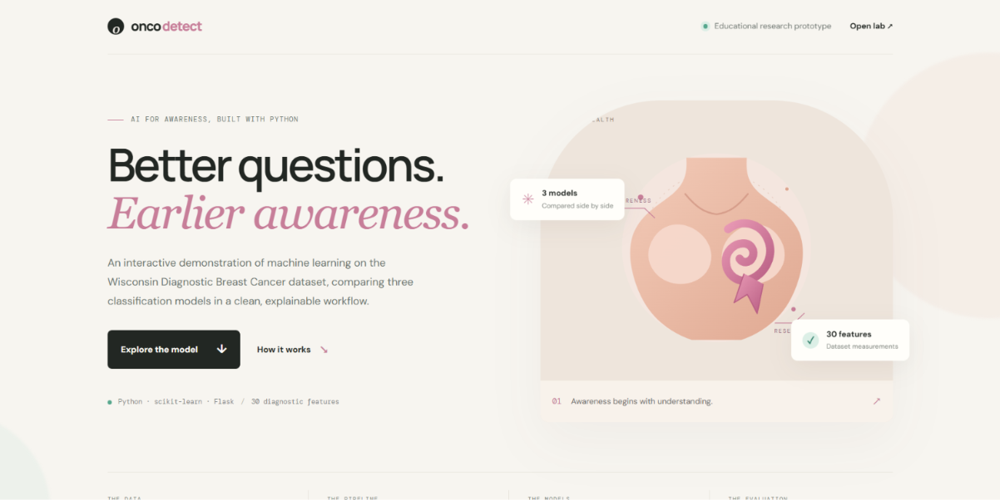
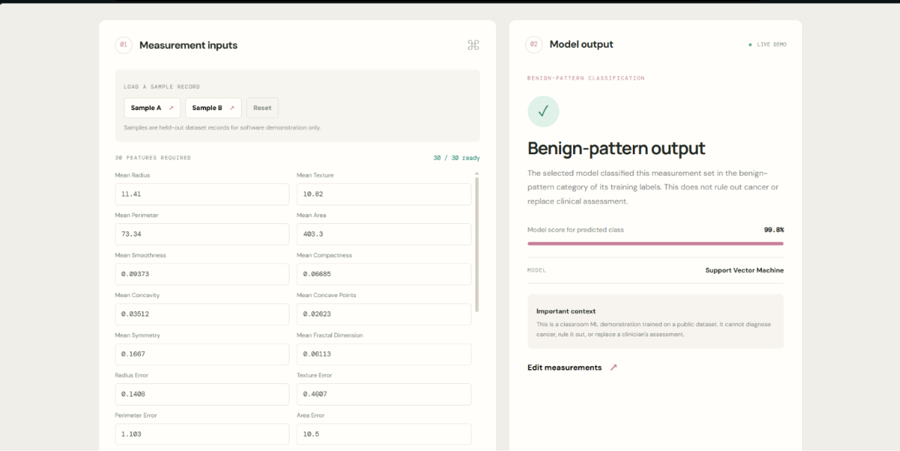
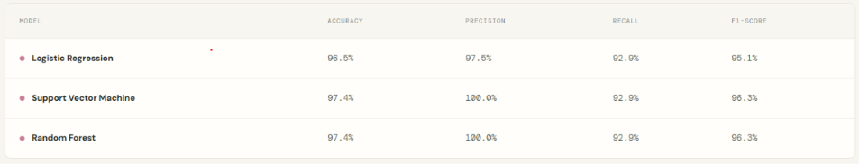

# OncoDetect | Breast Cancer Classification

A machine learning-based web application that classifies breast cancer data into benign and malignant categories.

Developed using Python, Flask and Scikit-learn.

## Features

- Breast cancer classification.
- Three machine learning algorithms.
- Interactive web interface.
- Real-time predictions.
- Model performance evaluation.
- Input validation.

## Machine Learning Models

| Model | Algorithm |
|---|---|
| Logistic Regression | Linear Classification |
| Support Vector Machine | RBF Kernel |
| Random Forest | Ensemble Learning |

## Dataset

This project uses the Wisconsin Diagnostic Breast Cancer dataset available through Scikit-learn.

- 569 samples
- 30 numerical features
- 2 classification categories

## Technologies Used

- Python
- Flask
- Scikit-learn
- NumPy
- HTML
- CSS

## Project Structure

```text
OncoDetect/
├── app.py
├── requirements.txt
├── runtime.txt
├── .gitignore
├── static/
│   └── style.css
├── templates/
│   └── index.html
└── tests/
    └── test_app.py
```

## Screenshots

### Homepage


### Prediction Results


### Model Performance


## Installation

Clone the repository:

```bash
git clone https://github.com/PussinBoots107/OncoDetect-Breast-Cancer-Detection.git
```

Navigate into the project:

```bash
cd OncoDetect-Breast-Cancer-Detection
```

Create a virtual environment:

```bash
python -m venv .venv
```

Activate it on Windows:

```powershell
.venv\Scripts\Activate.ps1
```

Install dependencies:

```bash
pip install -r requirements.txt
```

Run the application:

```bash
python app.py
```

Open:

```text
http://127.0.0.1:5000
```

## Running Tests

```bash
python -m unittest discover -s tests -v
```

## Author

**Shantanu Sen**

- GitHub: https://github.com/PussinBoots107
- LinkedIn: https://www.linkedin.com/in/senshantanu/

## Disclaimer

This project is developed for educational and academic purposes only. It is not a clinically validated diagnostic tool and should not be used for actual medical diagnosis or treatment decisions.
